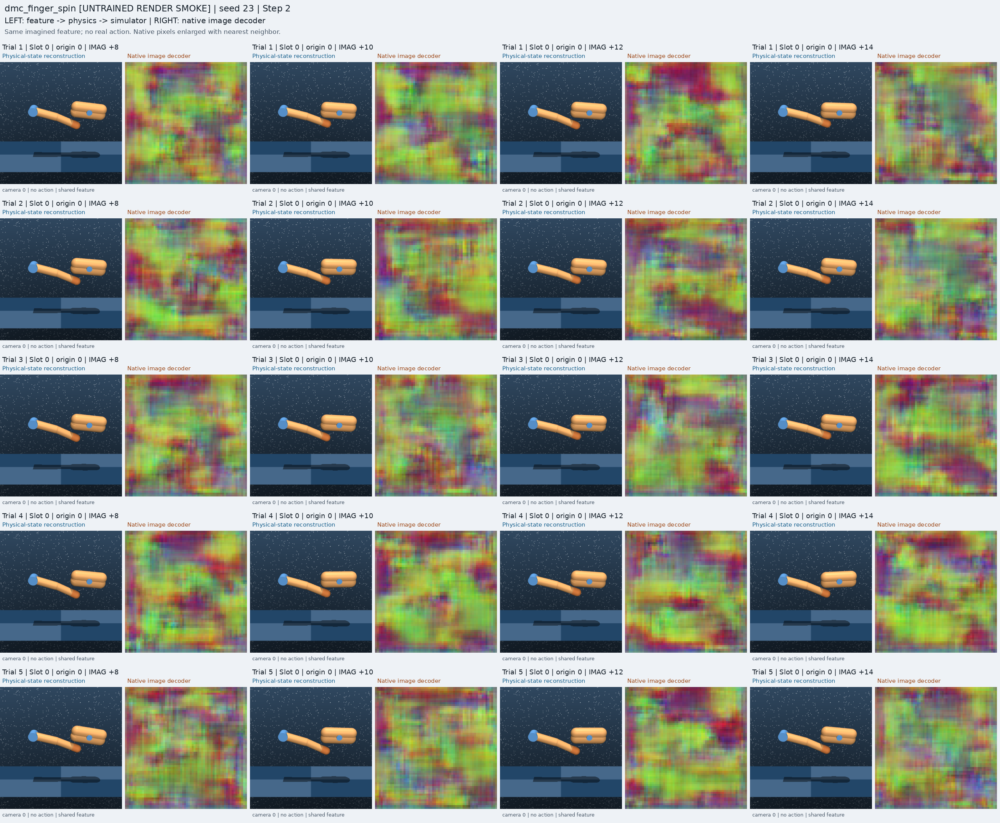

# dmc_finger_spin [UNTRAINED RENDER SMOKE] · Step 2

每对左侧为想象 feature → 在线物理 decoder → 仿真截图，右侧为同一 feature → 原生 image decoder。

想象深度：[8, 10, 12, 14]；实验次数：5；环境槽：[0, 0, 0, 0, 0]。每次实验各占一行，属于同一模型 seed；优先使用不同普通环境起点，起点不足时循环使用，每行独立采样想象动作与潜在状态，不复制已有图片。不会按重建质量挑选样本，不要求 guard 放行；失败格会明确标记。仿真副本中只设置已知起点上下文和预测状态，不执行动作。

这是训练中当前来源的可视化诊断，不是固定测试集的精度评估；左右都不是未来真实画面。原始共享 feature、动作链、预测核心状态及两路像素保存在 samples.pt，元信息见 manifest.json。

